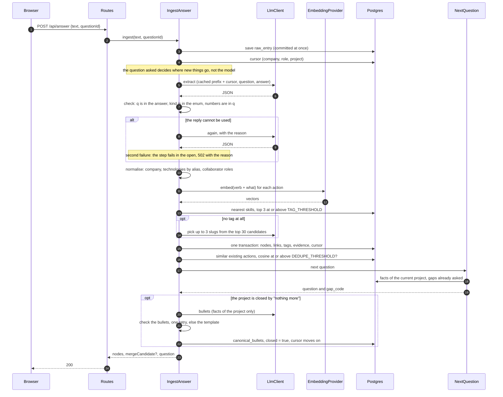
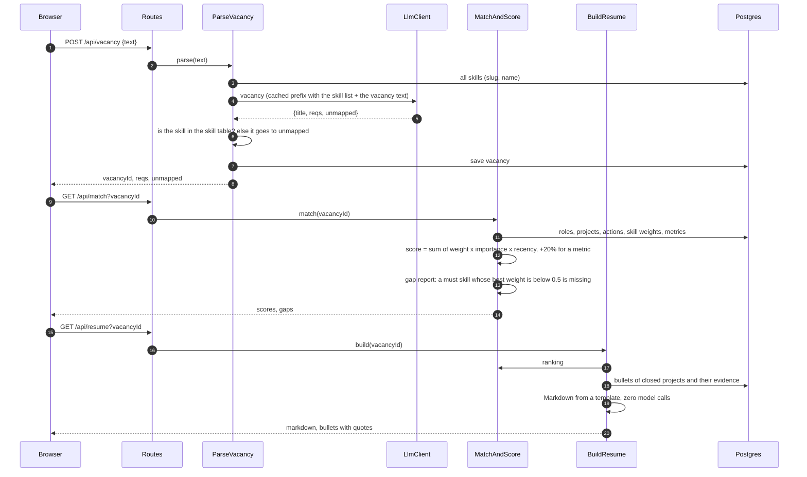
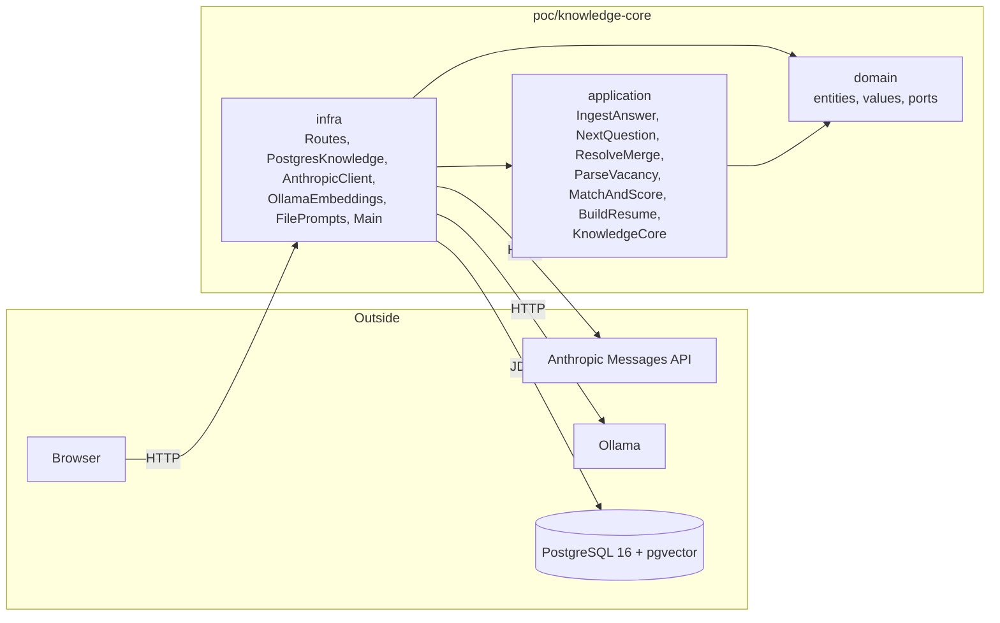
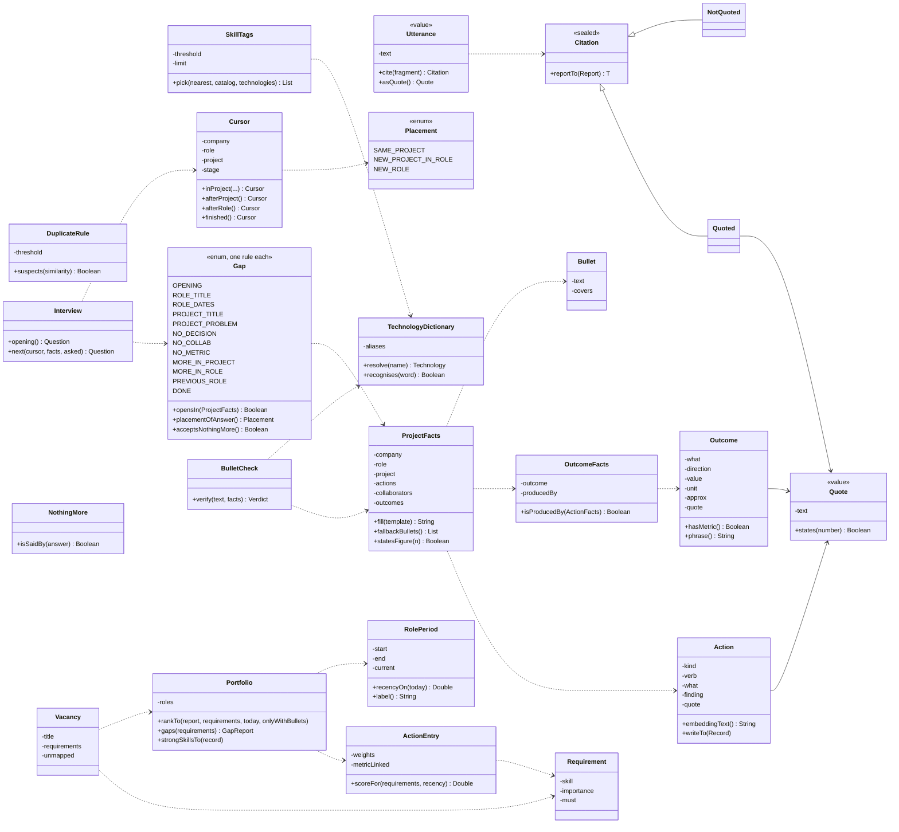
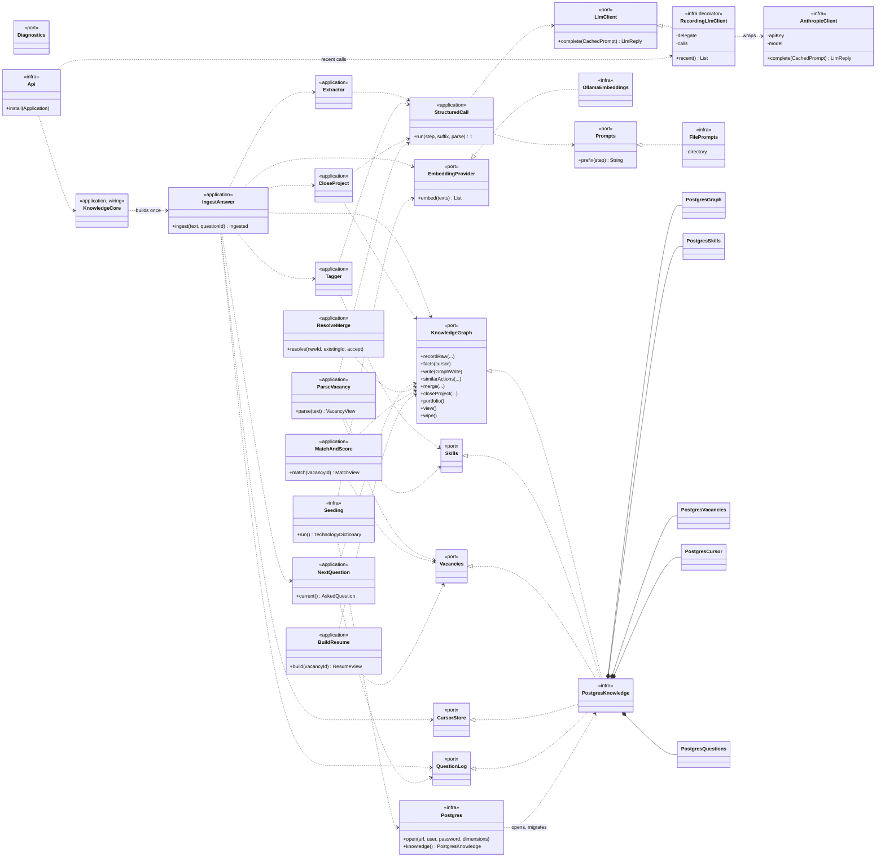
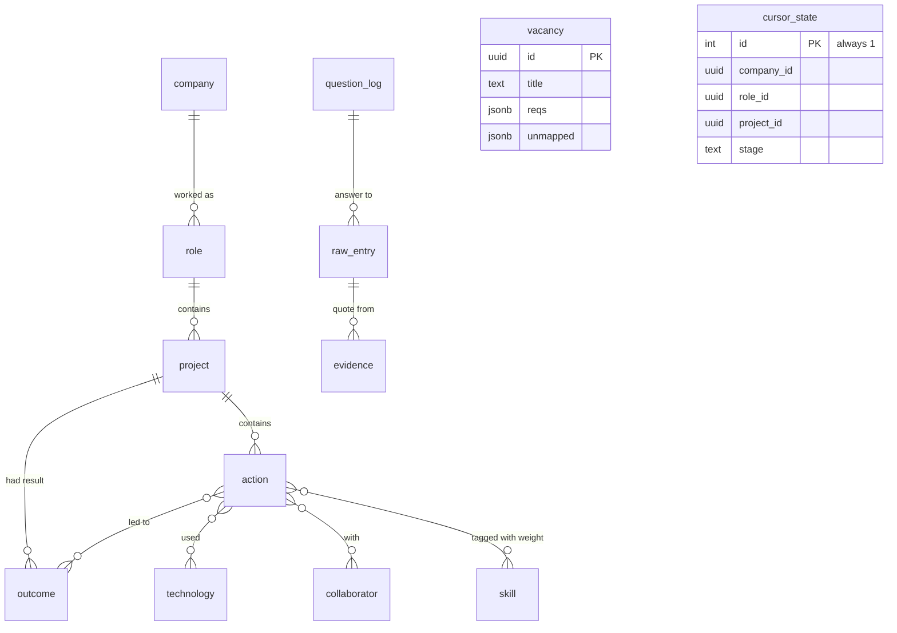

# ADR-101. The knowledge core is a proof of concept in a build of its own, and nothing in a résumé is invented

## Status

Accepted. The diagrams below were agreed on before the code was written and the code follows
them; where it had to differ, the diagrams here were changed in the same pull request and
"What differs from the plan" says how.

## Context

The product claim is that a résumé can be built from what a person says about their work, and
that every line of it can be traced back to their own words. Before building that into the
backend, there needs to be something runnable that shows the whole path, from a raw answer to a
structured graph, to follow-up questions, to a vacancy, to a résumé, and makes the cost of each
step visible.

## Decision

`poc/knowledge-core/` is a Kotlin/Ktor application with its own Gradle build, its own wrapper and
its own `docker-compose.yml`. It takes one hard-coded user, no authentication, no file import or
export. It is not part of `backend/settings.gradle.kts`, `modules.yaml`, the Konsist rules or
`check`; it shares nothing with `backend/` but the versions in its catalog, which are copied from
`backend/gradle/libs.versions.toml` so that moving a layer into `backend/modules/` later is a move
and not a rewrite.

**The one rule:** every fact in the résumé traces to something the person said. The model
structures and rephrases; it never invents. The rule is held in code, not in a prompt:

- a thing the model extracts carries `q`, an exact fragment of the answer, and is dropped if the
  fragment is not there (`Utterance.cite` is the only way to make a `Quote`);
- an outcome with a number cannot be built unless the number is written in its quote;
- a technology, a company or a figure in a résumé bullet must be among the facts of the project,
  or the bullet is refused, sent back once, and replaced by a template if it fails again;
- the résumé itself is assembled from a template with no model call.

### Decisions made with the owner

| Question | Decision | Rejected |
| --- | --- | --- |
| Where it lives | A separate Gradle build in `poc/knowledge-core/` in this repository | A spike in `backend/playground` (its build would compile the PoC on every `check`, and a spike is one question, one `main`); a separate repository (the thinking and the ADRs live here) |
| Data access | Exposed DSL, as in ADR-049, with a small column type and operator for pgvector | Plain JDBC (fewer parts, but adapters would have to be rewritten on promotion) |
| Dialogue position | One row in `cursor_state` | In memory (a restart in the middle of an interview would lose the position while the graph stays) |
| Delivery | Three pull requests: the domain and the application on in-memory fakes; the infrastructure and an offline integration test; the page, compose, README and an opt-in live test | One pull request |

### Layers

Three Gradle modules, as `backend/modules/*` has per layer, so the compiler and not a convention
keeps frameworks out of the domain.

```
domain/       entities, value objects and the ports; imports nothing but the JDK
application/  the use cases, the reading of the model's replies, KnowledgeCore (the wiring)
infra/        Postgres, the Anthropic and Ollama clients, Ktor routes, Main (the composition root)
```

Objects keep their fields private and are read and written through records (`writeTo(Record)`,
`reportTo(Report)`), as in the sessions module. Plain data appears in two places on purpose:
messages that cross a port (`WriteResult`, `GraphNode`, `LoggedQuestion`) and the response shapes
of the API (`Views.kt`). Collaborators are passed in; `KnowledgeCore` builds every use case once
from the ports it is given, and the server and the tests wire the same way.

## The flow: answer, graph, question

The model is called in three ways: to extract (for every answer), to pick skills (only when no
skill was found locally) and to write bullets (only when a project closes). Everything else is
local and deterministic.



`raw_entry` is committed first, as the specification has it: what the person said is never lost,
even if reading it fails. The graph is written in one transaction after the checks pass, so there
is no half-written graph.

## The flow: vacancy, score, résumé



## Module dependencies

An arrow reads "knows about". The PoC does not depend on `backend/` and is not part of its build.



## Classes

### Domain



`Utterance.cite` turns the rule that `q` must be an exact substring of the answer into a type: a
`Quote` cannot be made without proving the fragment is there. `Gap` holds the rule for each gap,
in the order they are asked, so there is one place to read the table of questions.

### Application, ports and infrastructure



In tests `AnthropicClient` is replaced by `ScriptedLlm`, which gives the replies of a script, and
`OllamaEmbeddings` by `ConceptEmbeddings`; the checks, the normalisation, the scoring and the
résumé are the real ones. `StructuredCall` is the one place that holds the rule "parse, check,
one retry with the reason, else fail in the open". `InMemoryKnowledge` implements every port the
use cases stand on and is the reference for how `PostgresKnowledge` must behave.

## Data

The schema of the specification, plus two tables it does not have. A `vacancy` row is what
`vacancyId` stands for; a `cursor_state` row (always id 1) keeps the position of the interview
across a restart. Four more columns are not in the specification's list: `seq`, an identity column
on the tables whose order matters (role, project, action, outcome, evidence, question_log),
`technology.seeded`, which lets a reset keep the technologies that came with the product and drop
the ones a person's answers added, and nothing else. `evidence` points to an entity by `entity_type` and `entity_id` with no foreign
key. The vector dimension is `EMBED_DIM` (768 for `nomic-embed-text`), passed to Flyway as a
placeholder, and the application refuses to start if the embedding model's output differs.



## Defaults the specification left open

- **Language of the data.** Roles, actions, technologies and bullets, and everything that is
  embedded, are extracted in English; `q` and evidence stay in the person's language. English
  embeddings are then enough; the model is chosen by `EMBED_MODEL` and `EMBED_DIM`, and changing
  it needs a reset and a fresh database volume.
- **Where new things go** is decided by the question being answered (`Gap.placementOfAnswer`).
  Fields of a role or project that already have a value are not overwritten; only empty ones are
  filled.
- **A gap about a role or project is asked once** per role or project. Without this, "no, I did
  not consider alternatives" would leave `NO_DECISION` open for ever. `MORE_IN_PROJECT` is
  exempt: it is asked after every addition.
- **"Nothing more"** is the specified keyword check, with Unicode word boundaries, applied only
  to the questions that can be answered so (`MORE_*`, `PREVIOUS_ROLE`, `NO_COLLAB`,
  `NO_DECISION`, `NO_METRIC`) and only to an answer of at most five words, so that "no problems
  with the cache, I also added a Kafka consumer" is read as an answer.
- **Opening and ending** are the gaps `OPENING` and `DONE`. "Nothing more" to `PREVIOUS_ROLE`
  ends the interview; a later answer starts a new role.
- **Merge.** A new action is stored at once and the interview does not wait for the answer.
  Accepting moves its links, tags and evidence to the existing action and removes it; declining
  keeps both.
- **Failure.** One retry with the reason, then the step fails with its name and the reason; the
  `raw_entry` stays and the graph is unchanged.
- **Recency** reads the year (and month, if written `YYYY-MM`) from `end_date`; a role with no end
  and no `is_current` gets no penalty.
- **Résumé** contains only closed projects, since only they have bullets.
- **Prompts** are `src/main/resources/prompts/*.md`, read from `PROMPTS_DIR` on every call so
  they can be edited without recompiling; the cached prefix is marked `cache_control: ephemeral`.
- **Debug drawer**: an in-memory ring buffer of the last 200 model calls with the four token
  counts, latency and raw JSON.

## What differs from the plan

- `GapRule` is not an interface: each entry of `Gap` holds its own rule and question. `Cursor`
  does not compute a placement; `Gap` does. `ActionScore`, `Recency` and `MatchReport` became
  `ActionEntry.scoreFor`, `RolePeriod.recencyOn` and `GapReport`, inside `Portfolio`.
- `KnowledgeGraph` is the one port for the graph; `Skills`, `Vacancies`, `CursorStore` and
  `QuestionLog` are separate ports, all implemented by one Postgres adapter. `KnowledgeCore`,
  `Extractor`, `Tagger`, `CloseProject` and `StructuredCall` are new in the application layer.
- The specification says every number in a bullet must be among the outcome values. The check
  also accepts a number in a finding the person gave about an action ("about 70% were repeated
  reads"), since that is something they said and the model is shown it.
- The specification says a bullet's technology names must be among the project's technologies
  "or known technology names". The check is stricter: a technology must be one the project used,
  under any of its spellings. Kafka is a technology the product knows, and it is still not
  something this person did if they never said so.
- Without a model, a result goes into a bullet only onto an action the person said produced it
  (`OutcomeFacts` keeps that link), and each result is used once. A result linked to no action
  stays in the graph and out of the fallback bullets.
- An answer is accepted only for the question that is pending. A retried or delayed response to
  a question already answered is refused, so it cannot move the interview or place facts under
  the wrong role.
- The `vacancy` table has no `raw_text`: the domain's `Vacancy` is the title, the requirements and
  what was unmapped, and nothing keeps the text it was read from.
- The technologies of `seed/technologies.json` are rows of the `technology` table, which is the
  alias table of the specification: the dictionary that normalises names is read from it at
  start. The skills are rows of `skill`, embedded at start if they have no vector yet or if their
  name or aliases changed.
- There is no vector index. The tables are small enough that an exact scan is faster than an
  index worth tuning, and an index would make the nearest skills approximate.
- Every call of an adapter is one transaction; what the person typed (`raw_entry`) is committed
  on its own before anything is read from it. pgvector answers `NaN` for the distance to a
  vector of zeros, which the adapter reads as similarity 0, as the fake does.
- `ANTHROPIC_URL` can point the client at another host (a proxy, a stub). A `.env` file in the
  working directory is read under the real environment. The prompts are read from `PROMPTS_DIR`,
  or from `infra/src/main/resources/prompts` when the application runs from the root of the
  build, on every call, so an edit applies to the next answer.
- The prompt prefix is marked for caching, and a model caches it only above its minimum length
  (1024 tokens for the larger models), so the short prompts (`tags`, `bullets`, `vacancy`) may
  show no cache reads; the debug drawer shows what each call really cost.
- The specification says "no metric" sets an outcome with `has_metric = false` so the gap
  closes. It does, and so does asking only once; the first is kept as specified.

## Consequences

- The domain and the application, with every rule above, run and are tested without a database,
  a network or a model. The infrastructure is held to the same contract by the same fakes.
- Promoting a layer into `backend/modules/` means moving it and giving it the module rules; the
  records, the ports and the use cases are already in that shape.
- `poc/knowledge-core` is not built by the backend's CI. It needs its own job if it is to be
  kept alive.
- What the tests cannot say is whether real embeddings put the right actions near the right
  skills at the thresholds `TAG_THRESHOLD` and `DEDUPE_THRESHOLD`. That is what the opt-in live
  test and the debug drawer are for.
