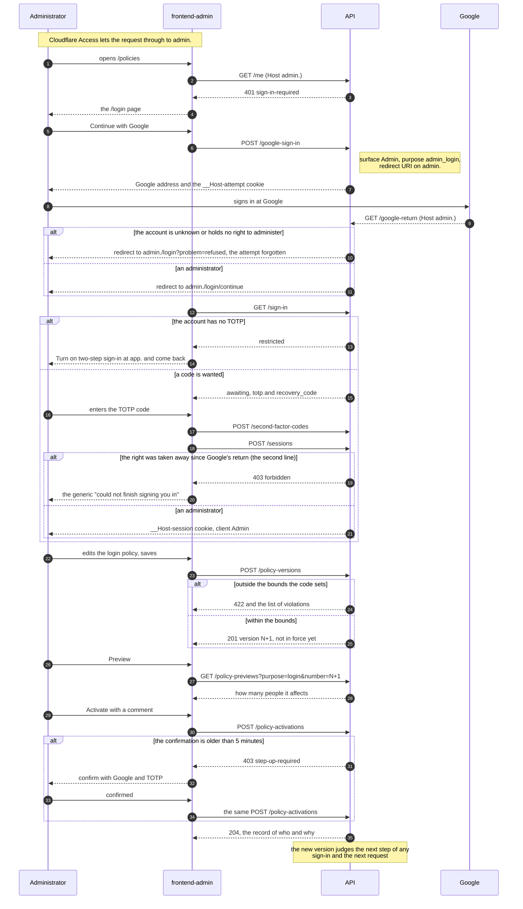
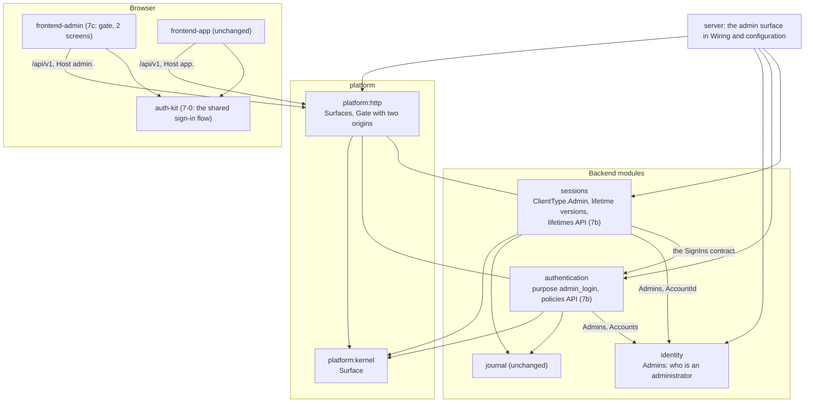
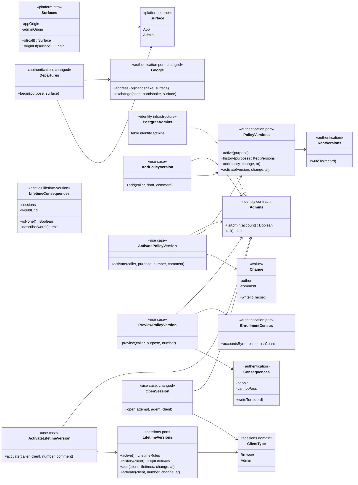
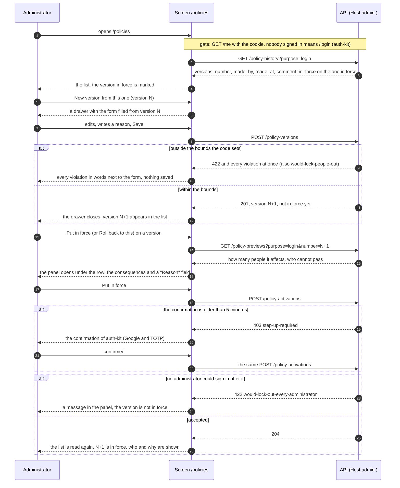
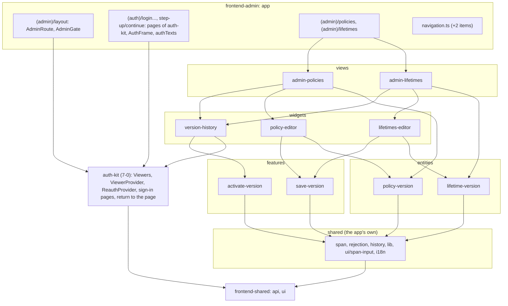
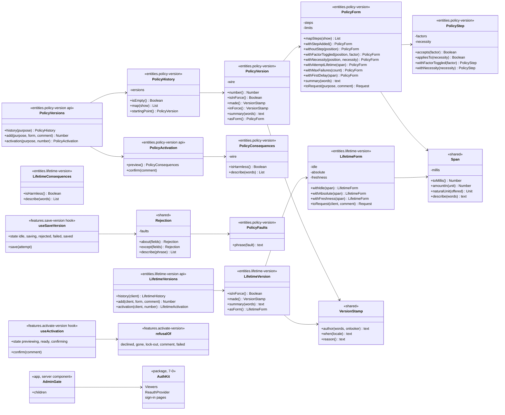

# Slice 7. The administrator signs in, and the sign-in policy and session lifetimes become editable

> Layers: `platform:kernel`, `platform:http`, `identity`, `authentication`, `sessions`, `server`, `ops` (7a); the same plus `docs/openapi.yaml` (7b); `frontend-admin` and a shared sign-in package (7-0, 7c)
> Status: plan accepted by Yurii on 2026-10-07. The diagrams below are the ones the code is written from. If the code departs from a diagram, the same PR changes the diagram.
> The decisions are recorded in [ADR-097](../adr/ADR-097-the-admin-surface-is-a-second-door-with-its-own-session-type.md) (7a) and [ADR-098](../adr/ADR-098-policies-and-lifetimes-are-edited-as-kept-versions-through-an-admin-only-api.md) (7b) and [ADR-099](../adr/ADR-099-the-admin-screens-edit-versions-behind-a-gate-built-from-the-sign-in-package.md) (7c).
> Parent documents: [ADR-078](../adr/ADR-078-factors-attempts-and-versioned-policies.md) (policies, bounds, floors), [ADR-079](../adr/ADR-079-server-side-opaque-sessions.md) (sessions), [ADR-090](../adr/ADR-090-devices-are-sessions-and-lifetimes-are-versions-owned-by-sessions.md) (lifetimes as versions), [ADR-092](../adr/ADR-092-a-dangerous-act-asks-for-a-fresh-proof-and-the-session-remembers-it.md) (fresh proof), [ADR-032](../adr/ADR-032-subdomain-split-and-admin-isolation.md) (the admin host)

Read it in this order: what we get and how it is cut into pull requests, which forks were answered, how an administrator signs in and changes a policy, who depends on whom, which classes it is made of.

## 1. What we should end up with

- **An administrator signs in on `admin.<domain>`** with Google, then a TOTP or recovery code, always (the `admin_login` purpose, which exists and is in force from version 1 but which nothing begins today). Cloudflare Access stays the first door; `admin_login` is the second. The session lives only on `admin.` and has lifetimes of its own.
- **Sign-in policies are editable** for every purpose: a list of versions with the author, the time and the comment, a new version, a preview of its consequences, activation and rollback.
- **Session lifetimes are editable** the same way, for the browser and for the administrator.
- **The bounds stay in code.** A version outside them cannot be saved; the answer names every violation.
- **Activation and rollback ask for a fresh proof** (Google and TOTP, five minutes, ADR-092) and record who did it and why.

### Pull requests

| PR | What is inside |
|---|---|
| **7-0** `frontend-app` and a new package | The sign-in flow moves from `frontend-app` into a shared package `auth-kit`, behaviour unchanged ([the plan](../frontend/03-auth-kit.md), [ADR-100](../adr/ADR-100-the-sign-in-flow-is-a-package-the-apps-give-their-words-and-frame.md)). The same PR changes one thing in `authentication`: see section 6. |
| **7a** backend | Who an administrator is, the second door (`admin.`), the `admin_login` sign-in, the session type `Admin` with its own lifetimes. |
| **7b** backend | Versions of policies and of lifetimes: list, create, preview, activate and roll back, with author and comment. |
| **7c** `frontend-admin` | Sign-in on `auth-kit`, the gate, the two screens. |

This document covers 7a and 7b in full and shows where 7c sits. The gate and the two screens of 7c are drawn in section 7.

## 2. Decisions

All five forks were answered on 2026-10-07. Four took the recommended option; fork 4 took the other one.

| Fork | Chosen | Why, in short |
|---|---|---|
| 1. How an account is known to be an administrator | **A.** A table `identity.admins` and a script `ops/grant-admin.sh`. | The right can be given and taken without a restart, it has a date, and it matches the set-of-capabilities model of ARCHITECTURE §7.4. The check in every request is one indexed lookup. |
| 2. A policy that demands a second factor from everybody | **B.** Forbidden by the bounds check for every purpose except `admin_login`; no session "only for setting up". | Building that session touches `Gate`, `Caller` and the sessions schema for one act. Meanwhile nobody can be locked out by a policy. The open flag of 5b (a retired seed and no codes left means Google alone is enough) stays open. |
| 3. Where author and comment are kept | **A.** Columns on the version and activation tables. | One row says what, when, who and why; history and rollback stay one structure (ADR-078). |
| 4. Sign-in screens in `frontend-admin` | **B.** A shared package `auth-kit`. | A bug in the sign-in is fixed once. What the sign-in asks for is decided by the server per purpose (`login` and `admin_login` have their own policies), so the package knows nothing about the two apps; the apps pass in their texts, frame and landing pages. |
| 5. Verify the Cloudflare Access header in Ktor | **A.** No. | ADR-032 made Access the network layer and `admin_login` the application layer; each does its own job, and a dependency on Cloudflare's keys is avoided. |

Decided without a fork:

- **Both hosts are served by the same routes.** Which door a request came through is read from its `Host` (`Surfaces`), never from a path or a body. The door decides the purpose of an attempt (`login` or `admin_login`), the redirect URI sent to Google, the page the browser is sent back to and the type of the session issued.
- **A session belongs to one door.** The server compares the type of the session with the door of the request: an `Admin` session does not work on `app.` and a `Browser` session does not work on `admin.`, even if the secret is carried over by hand. A session that does not fit is answered like an ended one, and is not deleted.
- **An unsafe request must come from the origin of its own door.** The `Origin` is compared with the origin of the door the `Host` names, so the origin of `admin.` is not accepted on `app.`.
- **An unknown Google account is not registered on `admin.`, and a known one without the right to administer is not let go on.** Both are answered alike, right after Google's return: the browser is sent back to `/login?problem=refused` and the attempt is forgotten, so an ordinary person is never asked for a code and is not told that the door exists. `OpenSession` still refuses a non-administrator with `403 forbidden`, as the second line.
- **A person without TOTP is not let into `admin.`.** `GET /sign-in` says `restricted`; the page tells them to turn on two-step sign-in on `app.` and come back (no session is issued for it).
- **Admin routes answer only on `admin.`** and every use case checks that the account is still an administrator; taking the right away works from the next request (7b).
- **A new version needs no confirmation, its activation does.** A version in the list changes nothing until it is made active. A rollback is the activation of an earlier version.
- **A preview is of a kept version** (`GET /policy-previews?purpose=…&number=…`), the same for a new version and for a rollback; there is no draft on the server.
- **An activation that would leave no administrator able to sign in is refused** (`422 would-lock-out-every-administrator`, not the `409` first drawn; see section 7). An emergency way, a row of SQL that adds an activation of the previous version, goes into the ops runbook.
- **Lifetimes of the administrator by default:** idle one hour, absolute eight hours, freshness five minutes. They are values, changed on the new screen.
- **Deploy.** A second redirect URI is registered with Google, `https://admin.<domain>/api/v1/google-return`, and the server gets `TALLYVANE_ADMIN_ORIGIN`.
- **Strings** on the screens are English, in the translations of the shared package or of the app.

## 3. How an administrator signs in and changes a policy (diagram 1)

## 4. Module dependencies (diagram 2)

No module is added. The direction of reading is as before, `sessions` to `authentication` to `identity`; the one new line is that `sessions` and `authentication` ask `identity` whether an account is an administrator.

## 5. Classes (diagram 3)

The same rules as before: fields are private, behaviour is in methods, state leaves through a `Record` or a `Report`. Names are provisional until the code is written.

## 6. What changed while implementing

Slice 7a is built. The diagrams above are the ones it was written from; this is where the code differs from them or adds to them.

- **`Admins` offers one method.** Diagram 3 shows `all()` as well. Nothing in 7a needs the list of administrators; it comes with 7b, where an activation that would lock out every administrator is refused.
- **`BeginSignIn.begin(surface)` chooses the purpose.** The door is passed down to the application layer and the use case maps it (`App` to `login`, `Admin` to `admin_login`), so the web layer does not know purposes. `Departures.begin(purpose, surface)` and `Google.addressFor / exchange(…, surface)` are as drawn; `ContinueWithGoogle` and `BeginStepUp` take the surface too, and `GoogleReturnRoutes` reads it from the `Host` of the return.
- **The step-up confirmation is per door as well.** `ConfirmStepUp.confirm(session, attempt, surface)` recognises the session on the door of the request, so a session of the other door confirms nothing and the confirmation is not spent. This is not in the diagrams; without it the one route that reads the session cookie itself would have been the way round the rule that a session works only on its own door.
- **`ClientType` knows its door** (`ClientType.on(surface)`), which is the only place `Surface` and the kinds of session meet. `Session.isHeldOn(surface)` is what `Recognition` asks.
- **A stranger on `admin.` is turned back in `GoogleTrips.land`**, in the transaction that records Google's answer: the attempt is forgotten and the browser is sent to `/login?problem=refused`.
- **The refusal of a non-administrator keeps the sign-in.** `OpenSession` rolls back when `Admins` says no, so the completed sign-in is still kept and ends on its own. The answer is `403 forbidden`, not a code of its own.
- **Configuration.** `TALLYVANE_ADMIN_ORIGIN` is mandatory and must have another host than `TALLYVANE_APP_ORIGIN`; the server refuses to start otherwise, naming the variable. `ops/docker-compose.yml` defaults it to `https://admin.<DOMAIN>`.
- **No `admin` lifetime row is seeded (ADR-066).** The previous release reads every lifetime row it finds and does not know the word `admin`, so a row added by the migration would make it fail while the two colours run side by side. Instead `ClientType.Admin` carries starting lifetimes (an hour idle, eight hours absolute, five minutes of freshness) that `LifetimeRules` uses while no version of the administrators' lifetimes is kept, and the reading of the lifetime versions skips a kind it does not know. The first version row is added by the versions API of slice 7b, in a release after this one. The same tolerance lets a later release add a kind of client without stopping this one.
- **A person without the right is turned back before the code (changed with slice 7-0, at the owner's request).** In 7a only an unknown Google account was refused on `admin.`; a known account without the right went on to the code and was refused with `403 forbidden` when the session was opened. `GoogleTrips.land` now asks `Admins` for an `admin_login` attempt and turns an account without the right back exactly like a stranger (`/login?problem=refused`, attempt forgotten), so nobody who may not administer reaches the code screen. `OpenSession` keeps its check as the second line. `GoogleTrips` takes `Admins` for this; the composition root passes `identity.admins`.
- **Not verified here.** A real Google sign-in on `admin.`, Cloudflare Access in front of it, and the deploy steps (the second redirect URI at Google, `TALLYVANE_ADMIN_ORIGIN`, `ops/grant-admin.sh`). The integration tests ran against PostgreSQL 16, not the 17 image of the fixture.

### Deploy checklist for 7a

1. Register `https://admin.<domain>/api/v1/google-return` as a second authorised redirect URI of the Google OAuth client.
2. Set `ADMIN_ORIGIN` in the server's `.env` if the admin host is not `admin.<DOMAIN>`.
3. After the deploy, sign in once on `app.` with the administrator's Google account, turn TOTP on, then run `ops/grant-admin.sh <email>` on the server.

## 7. Slice 7b: the versions API

Slice 7b is built. The diagrams above are the ones it was written from; this section is where the code differs from them and the contract the screens of 7c are written against. The wire shapes are in `docs/openapi.yaml`; this is the summary.

### Routes

All eight are served on the administrators' site only (`RouteModule.door = Surface.Admin`; on `app.` they answer `404`), only to an administrator (`403` otherwise, checked again by every use case), and none is cached. A `POST` takes an `Idempotency-Key`. The two activations need a fresh proof (`403 step-up-required`, then `POST /step-ups`).

| Route | Answer |
|---|---|
| `GET /policy-history?purpose=` | `200 {purpose, versions[]}`, newest first. A version: `number`, `made_by?`, `made_at`, `comment?`, `in_force? {since, by?, reason?}`, `steps[{accepts[], necessity}]`, `attempt_lifetime_millis`, `max_failures`, `first_delay_millis`. |
| `POST /policy-versions` | `201 {purpose, number}`; `422` with every violation at once. |
| `GET /policy-previews?purpose=&number=` | `200 {people, cannot_pass}`; `404` for a version nobody kept. |
| `POST /policy-activations` | `204`; `404` no such version; `422` on `number` with `would-lock-out-every-administrator`. |
| `GET /lifetime-history?client=` | `200 {client, versions[]}`: `number`, `made_by?`, `made_at`, `comment?`, `in_force?`, `idle_millis`, `absolute_millis`, `freshness_millis`. |
| `POST /lifetime-versions` | `201 {client, number}`; `422` with every violation at once. |
| `GET /lifetime-previews?client=&number=` | `200 {sessions, would_end}`; `404` for a version nobody kept. |
| `POST /lifetime-activations` | `204`; `404` no such version. |

A `422` is the usual problem body with `errors[{field, code}]` and a `detail` of the sentences fit to show. Codes: `purpose|client/unknown`; `comment/comment-invalid`; for a policy `steps/would-lock-people-out`, `steps/below-the-floor`, `steps/nothing-identifies-the-account`, `steps[i].accepts/empty`, `attempt_lifetime_millis|max_failures|first_delay_millis/out-of-bounds`; for lifetimes `idle_millis|freshness_millis/out-of-bounds`, `absolute_millis/out-of-bounds|below-idle`.

### Where the code differs from the plan

- **Eight routes, not six.** The plan named the routes that write and preview; a screen also has to read the versions it edits, so each of the two screens has a history route as well. The names are plural nouns (`policy-versions`, `policy-activations`) because the arch rules take one noun per route file.
- **The lock-out is `422`, not `409`.** The request is well formed and the data it names is what is wrong, the same as for a version outside the bounds, so a client reads one shape: `errors` on a field (`number`).
- **The door is enforced at the edge.** The plan said admin routes answer only on `admin.`. `RouteModule.door` and the route-scoped plugin `DoorOnly` in `platform:http` do that for any module, by the surface the `Host` names. The `Gate` still runs first, so an anonymous request for such a route on `app.` is answered `401` and not `404`.
- **`Change` and `Fault` exist once in `authentication` and once in `sessions`.** Neither module may read the other's application layer, and a shared kernel type for two small values was not worth a new dependency.
- **The administrators' lifetimes become version 1 in a migration.** 7a left the row to the code; the 7b migration inserts it with its activation, with the same numbers (an hour, eight hours, five minutes), now that the release before it knows the word `admin`. A version a migration made has no author and no comment.
- **A preview is of a kept version**, as decided; the screen adds the version first and previews it by number. A rollback preview is the same call.
- **What `cannot_pass` counts.** Everyone in `people` who could not get to the end of the policy with the factors they have set up: for `admin_login` the administrators; for the other purposes all accounts, and a policy within the bounds cannot shut anyone out of them, so the count is `0` there.
- **`Admins.all()` arrives** (the plan showed it in diagram 3) with `Accounts.count()` and the `EnrollmentCensus` port, which counts accounts by the factors they have set up in one grouped query.
- **Not verified here.** The Postgres integration tests ran against PostgreSQL 16, not the 17 image of the fixture. The emergency rollback SQL for the ops runbook is not written yet.

## 8. Slice 7c. The gate and the two screens

> Layers: `frontend-admin` (the gate and the screens), the shared sign-in package `auth-kit` (7-0, merged), the generated client types of `frontend-shared` (7b, merged).
> Status: implemented. The diagrams below are the ones the code was written from, updated in the same pull request where the code departed from the plan (see 8.7). The decision is recorded in [ADR-099](../adr/ADR-099-the-admin-screens-keep-versions-in-place-and-let-the-server-judge-the-bounds.md).
> The diagrams follow the contract of 7b as merged in `docs/openapi.yaml` (section 7): admin-only paths on `admin.`, snake_case JSON, durations in milliseconds, a version carries `in_force` (with `since`, `by`, `reason`) only while it is the one in force, and `made_by` and `comment` are absent for versions a migration made.
> The look follows the board "S9 · admin policies" of the design canvas "Tallyvane auth screens" (`https://claude.ai/artifact/PkNFQuxQyAxz7aA7j47ZUf`): one elevated card titled "Versions", a row per version with its number, a one-line summary, the "In force" badge, who and when, and the acts at the right; consequences in an amber callout with the reason below it. The canvas shows the activation as a modal window; the product has none (ARCHITECTURE §12.9, ADR-091), so the same content opens in place under the row.

### 8.1 What we should end up with

- **A gate in front of every page of `frontend-admin`** (the three CMS placeholders too). The server asks `GET /me` with the visitor's cookie and the `admin.` host; nobody signed in means `/login`, remembering where the person was going. A person without the right never gets as far as the code (the server turns them back after Google, as 7-0 did), so the app has no "no access" state. The mechanics come from `auth-kit`; the app passes its texts, frame and landing page. An administrator without an authenticator reaches the `restricted` state, whose text the app supplies and which points at the console, where the authenticator is set up.
- **"Sign-in policies"** at `/policies`: a purpose picker (`registration`, `login`, `admin_login`, `step_up`), the versions of that purpose (number, a line saying what it holds, author, time, reason, an "In force" badge), "New version from this one" (a drawer with a form filled from the chosen version: steps with the factors each accepts and whom it applies to, attempt lifetime, maximum failures, first delay) and "Roll back to this" on an older version.
- **"Session lifetimes"** at `/lifetimes`: a "Browser / Administrators" picker, the same list of versions, a form of three lengths (unused for, lives at most, proof stays fresh for), activation and rollback.
- **Violations are shown at the form.** The server names every one (`422`); the screen words them next to the field they belong to, or in a list above the buttons, and saves nothing. The bounds are not copied into the screen: the server's code knows them.
- **Activation and rollback share one in-place panel.** It loads the consequences, asks for a reason and, when the confirmation is older than five minutes, the confirmation of `auth-kit` rises by itself and the request is repeated.

### 8.2 Decided without a fork

- **The consequences load with the panel** instead of behind a separate button: a version cannot be put in force without its consequences in front of the person. The request is the `GET /policy-previews` (or `/lifetime-previews`) of diagram 4, by the number of a kept version.
- **A rollback is an activation** of an earlier version: the same panel and request, a different title and button label. A version newer than the one in force is "Put in force"; an older one is "Roll back to this".
- **A new version always starts from a copy of an existing one**, edited as a set of steps. The button in the top bar starts from the version in force. There is no empty form and no free-text (JSON) editing.
- **No modal windows.** Creation happens in a drawer, activation in place under the row.
- **The menu** gets "Sign-in policies" and "Session lifetimes" next to Pages, Media and Strings. `/` still redirects to `/pages`, which is also where a finished sign-in lands.
- **Authors are shown as "You", a short form of the account id, or "Migration".** The contract carries `made_by` as an account id and no names.
- **Loading, failure and empty states** are shown the way the Devices and Activity pages of the console show them.
- **Strings** are English, in the app's dictionary; styling only with classes on the design-system tokens, through the primitives of `frontend-shared`.

### 8.3 How the policies screen works (diagram 4)

The administrator's own sign-in is diagram 1. The lifetimes screen is the same with `/lifetime-history`, `/lifetime-versions`, `/lifetime-previews` and `/lifetime-activations`, keyed by the client (`browser` or `admin`) instead of the purpose.

### 8.4 Module dependencies (diagram 5)

`version-history` knows no entity: it asks every version the same few questions (`Listed`), and the view hands it the way to summarise a version, the activation to run and the words for its consequences. The two entities do not know each other either; what they share (a length of time, a rejection, who made a version) is in the app's own `shared`.

### 8.5 Classes (diagram 6)

The same rules as before: fields are private and behaviour is in methods. The answer of the server becomes an object at the border, and the screen asks the object ("how are you shown", "are you in force") instead of taking the answer apart. Forms are values: every edit gives a new one.

### 8.6 Out of scope

Managing people and giving the administrator right from the interface; a policy journal on the screen (the author and reason are shown in the list of versions itself); names instead of account ids in the list (the contract carries ids); a sign-out button and account menu on the administrators' site; a session "only for setting up"; the CMS editors (the placeholders stay placeholders, but sit behind the gate).

### 8.7 What changed while implementing

- **The activation is a panel under the row, not a dialog**, and "New version" is a drawer. The plan said "dialog"; the product has no modal windows (ADR-091), and the design canvas that the screens follow shows the same content as a card. Diagram 4 and the classes say so.
- **`Rejection` is generic and the wording is per entity.** Instead of one `Rejection` that knows every field, `shared/rejection` holds the faults the server named (`about` a field, `except` some, `describe`), and `PolicyFaults` and `LifetimeFaults` turn a fault into a sentence. `ProblemError` gained `faults()` and `detail()` for it.
- **`Consequences` became `isHarmless()` and `describe(words)`**, shared by both entities in shape (an interface of the activation feature), not in code.
- **The administrators' site reaches the API through its own internal name.** The backend picks the door (app or admin) from the request `Host` alone (ADR-097), and a server-side `fetch` of Node drops a `Host` that it is told to set. The gate of the admin site would therefore have been answered as the public door and sent to `/login` in a loop. `ops/nginx` has a second internal name, `nginx-admin`, that sets `Host: admin.<domain>`; `frontend-admin` calls the API through it (`TALLYVANE_API_INTERNAL_URL=http://nginx-admin`), and its health check is `/login`, which needs no session.
- **A save or an activation that is repeated keeps its `Idempotency-Key`.** The contract says the key is generated once per intention and sent again unchanged (ADR-086). `IntentionKey` in the app's `shared` holds it while the same request is repeated after an answer that never came (a network drop, a `5xx`, a `409` or `429`), and starts a new one when the request changes or the server turned it down (`ProblemError.wasRefused()`), so a lost response cannot keep a second version.
- **Nothing in the server's contract changed.** The screens needed no new field.
