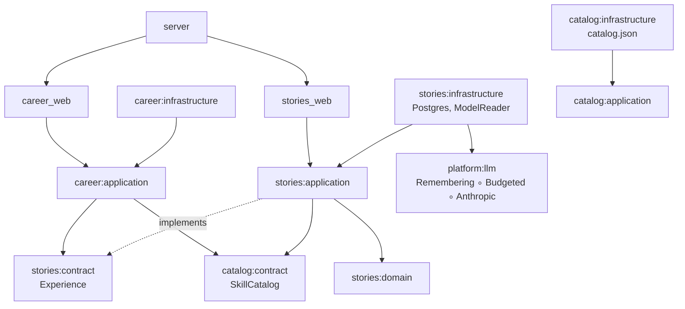
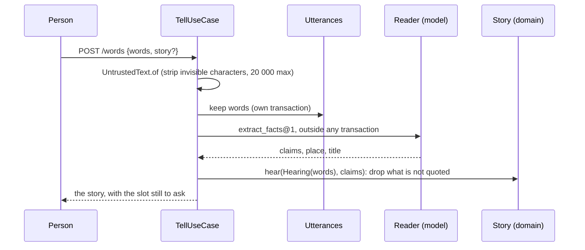

# Product core: words, facts, skills, route, step

The backend of the product itself (design variant E). One idea runs through it: the person's own words are
the only source of truth, and everything else is derived from them.

```mermaid
flowchart LR
    W[Words<br/>stories.utterances] -->|extract_facts@1<br/>checked by the domain| F[Facts with quotes<br/>stories.facts, stories.quotes]
    F --> S[Skill standing<br/>confirmed / growing / gap]
    C[Catalog<br/>skills, role tracks] --> S
    G[Goal<br/>career.goals] --> R[Route]
    S --> R
    R --> H[One next step<br/>GET /home]
    F --> CV[Résumé by selection<br/>GET /resume]
```

## Five laws

1. **Words are immutable.** `stories.utterances` is only added to, and before the model is asked.
2. **No quote, no fact.** A claim becomes a fact only if each fragment is an exact substring of the words and
   each figure is written in a fragment (`Hearing`, `Quote` in `stories:domain`).
3. **The model translates, rules decide.** The next step, the route levels and the résumé are chosen by code,
   0 tokens (`career:application`).
4. **Pay once.** `platform:llm` remembers every answer by spec, model, instructions and input
   (`platform.model_memo`) and caps each person's tokens a day (`platform.model_spending`).
5. **Initiative is the person's.** Nothing suggests a vacancy to apply to (ADR-040).

## Modules



- `platform:llm`: the shared model gateway. `ModelFactory.model(...)` builds
  `RememberingModel(BudgetedModel(AnthropicModel | Model.Absent))`. Without `ANTHROPIC_API_KEY` every call
  answers *unavailable*, and the product still runs.
- `catalog`: the curated skills and role tracks, shipped as a file.
- `stories`: words, stories and facts; `TellUseCase`, `CorrectFactUseCase`, `ShowStoriesUseCase`; exposes
  `Experience` to other modules.
- `career`: the goal, the home (`ShowHomeUseCase`) and the résumé (`ShowResumeUseCase`).

## Telling, step by step



## Prompt injection

The words travel to the model only as the value of a JSON string field, under a system prompt that names that
field as data. Whatever the model answers, nothing reaches storage unless it quotes the person's own words
exactly, so an injected instruction can at worst produce a fact the person actually said.

## The home ladder

`tell_first` (nothing told) → `set_goal` → `finish_story` (a story with a slot missing: system, role,
outcome, scale) → `close_gap` (the route skill with the largest importance × (1 − level)) → `keep_going`.
A skill is *confirmed* by two facts in stories that have a result, *growing* with one, a *gap* with none.

## Specs

The model calls are fixed in [`docs/specs/model`](../specs/model/README.md); the HTTP API in
[`docs/openapi.yaml`](../openapi.yaml).

## Model providers (set in Admin)

No vendor is assumed. An administrator adds providers on the Admin "Models" screen (`/models`):
Anthropic or any OpenAI-compatible endpoint (OpenAI, OpenRouter, Gemini, DeepSeek, Ollama), a key
(sealed with Tink under the TOTP keyset, associated data `platform-model-provider-key-v1`), a fast
and a careful model, and prices per 1M input/output tokens. One provider is active at a time.
Every call is logged in `platform.model_calls` with its cost (0 when served from the memo), and the
screen shows 30 days of cost by provider, model and spec. The memo key includes the provider kind,
base URL and model, so switching providers never reuses another model's answer. With no active
provider, model calls answer unavailable and the person's words are still kept.
Model memo, spending and call log write through `Persistence.bookkeeping`, outside the request's
claimed transaction (ADR-086).
