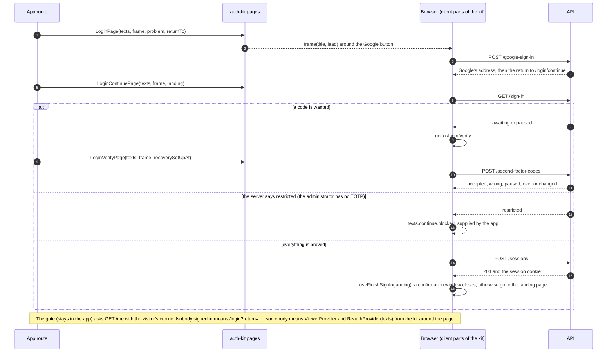
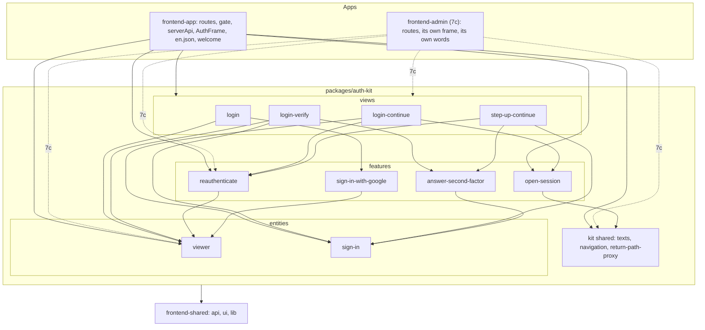
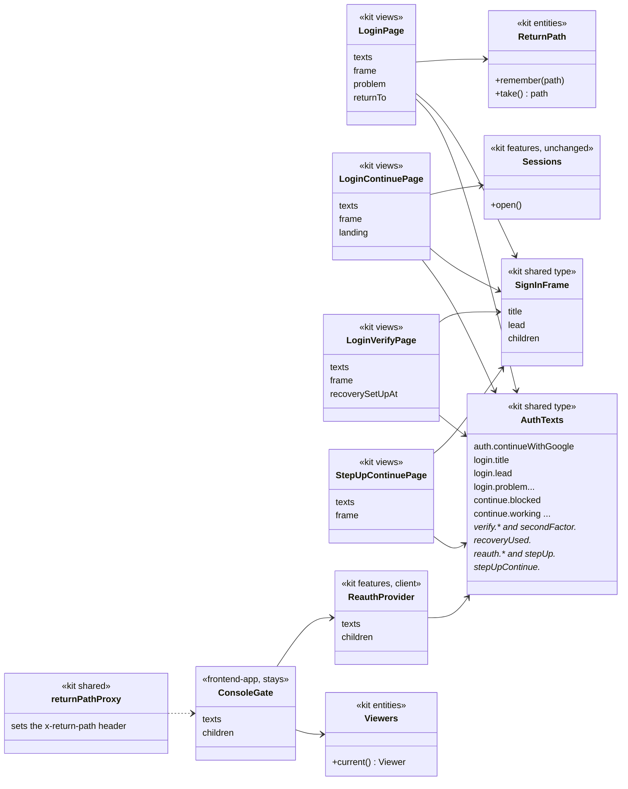

# Slice 7-0. The sign-in flow becomes a shared package, `auth-kit`

> Layers: `packages/auth-kit` (new), `frontend-app`; `frontend-admin` follows in slice 7c
> Status: plan accepted by Yurii on 2026-10-14. The diagrams below are the ones the code is written from. If the code departs from a diagram, the same PR changes the diagram.
> The decision is recorded in [ADR-100](../adr/ADR-100-the-sign-in-flow-is-a-package-the-apps-give-their-words-and-frame.md). Parent documents: [the plan of slice 7](../backend/07-authentication-slice-7-admin.md) (fork 4: one shared package, the server decides what a sign-in asks for per purpose), [ADR-094](../adr/ADR-094-the-code-screens-ask-the-server-where-the-attempt-stands.md) (the code screens).

Read it in this order: what we get, which forks were answered, how one sign-in runs through the package, who depends on whom, which classes are new or changed.

## 1. What we should end up with

- A package `packages/auth-kit` that holds the whole sign-in flow, moved out of `frontend-app` with its tests: the viewer, the state of an attempt and its second step, the screens for signing in, entering a code and confirming a dangerous act, and the prompt that asks to sign in again when the session ends under a page.
- `frontend-app` is the only consumer in this slice, and the console behaves exactly as before. Slice 7c adds the second consumer, `frontend-admin`.
- The package knows nothing about either app. What differs arrives as a parameter: **the words** (one typed object, `AuthTexts`), **the frame** (the component each screen is drawn in) and **the landing page** (where a finished sign-in goes).
- What a sign-in asks for stays the server's decision, per purpose (`login`, `admin_login`). Nothing in the package says "the administrator needs TOTP".

### What moves and what stays

| In `frontend-app/src` | Goes to | Note |
|---|---|---|
| `entities/viewer` | `auth-kit` `entities` | `Viewer`, `Viewers`, `ViewerProvider`, `ReturnPath`, `GoogleSignIn`, `GoogleStepUp` |
| `entities/sign-in` (with 3 tests) | `auth-kit` `entities` | `SignIns`, `SignInState`, `CodeAnswer`, `CodeOffer`, `RecoveryNotice`, `useSignInState` |
| `features/answer-second-factor`, `open-session`, `sign-in-with-google`, `reauthenticate` (with 2 tests) | `auth-kit` `features` | words and the landing page become parameters |
| `views/login`, `login-continue`, `login-verify`, `step-up-continue` | `auth-kit` `views` | take `texts` and `frame` |
| `app/return-path-proxy.ts`, `shared/navigation/Redirect` | `auth-kit` `shared` | the proxy helper and the header name the gate reads |
| `widgets/console-gate`, `shared/api/serverApi.ts`, `widgets/auth-frame`, `views/welcome`, `features/register`, `app/routes`, `en.json` | **stay in the app** | the gate and the server-side API are each app's own (fork 3); the frame belongs to the app; registration is for the console only |

## 2. Decisions

The forks were answered on 2026-10-14.

| Fork | Chosen | Why, in short |
|---|---|---|
| 1. Where the words of the sign-in screens live | **A.** The package has no words; the app passes a complete `AuthTexts`. | The console builds `AuthTexts` from its own dictionary and the dictionary does not change, so behaviour is unchanged by construction. A key left out is a compile error in the app. English defaults in the package can be added later (`defaultAuthTexts`) without touching a component. |
| 2. A "no access" state in the package | **None.** The requirement is stronger: an ordinary person must not get any access to the administrators' site, not even as far as a refusal after the code. | The server refuses a Google account without the right to administer right after Google's return on `admin.`, as it already does for an unknown one (same answer, `/login?problem=refused`). `OpenSession` keeps its own check as the second line. Done in the same pull request; see [the plan of slice 7](../backend/07-authentication-slice-7-admin.md), section 6. |
| 3. The gate and the server-side API | **B.** They stay in each app. | The package holds the parts (`Viewers`, `ViewerProvider`, `ReauthProvider`, the header name of the return path) and not the gate itself. If the duplication of the two short files starts to hurt, they can move to a small package of their own later without touching a screen. |

Decided without a fork:

- **The words are one object.** A page receives the whole `texts: AuthTexts`. Substitution of `{name}` goes through the existing `createUseStrings` of `frontend-shared`.
- **The frame is passed as a component.** The pages stay server components and call `frame` on the server; client parts receive only plain values (strings), so no function crosses the server-to-client boundary.
- **The landing page and the page for setting the authenticator up again are parameters.** `useFinishSignIn(landing)` replaces a hard-coded `/today`. The "Set up now" button after a recovery code is shown only if the app passes an address (`recoverySetUpAt`); the console passes `/settings/security`.
- **Imports between slices inside the package are relative.** The `@/` alias belongs to the app's `tsconfig`, which Next uses for transpiled workspace packages too, so it cannot point into the package. `content-kit` is built the same way.
- **`next` is a peer dependency.** The screens navigate with `next/navigation` and the return-path helper is a Next proxy. The package makes sense only inside a Next app.
- **Tooling.** The package has its own `tsconfig`, `steiger.config.ts`, `.dependency-cruiser.cjs` and `vitest.config.ts`, is covered by the same ESLint rules as the apps (no raw tags, design tokens, vendor wrappers), and is listed in `transpilePackages` and the Dockerfiles. `frontend-admin` is not changed in this slice.

## 3. How one sign-in runs through the package (diagram 1)

## 4. Module dependencies (diagram 2)

The layers inside the package are the apps' layers (FSD), arrows point down. The apps see the package only through its entry points, as they see `content-kit`.

## 5. Classes (diagram 3)

The same rules as before: fields are private, behaviour is in methods, the server's answer becomes an object at the boundary. The classes that move (`SignIns`, `SignInState`, `CodeAnswer`, `ReauthSession` and the rest) do not change, so only what is new or changes its signature is drawn.

## 6. What changed while implementing

The diagrams above are the ones the code was written from; this is where they differ from the plan Yurii accepted.

- **No "no access" state, no session gate in the package.** The first plan drew both (`SessionGate`, `Opened`, `continue.noAccess`); the answers to forks 2 and 3 removed them, and the diagrams here are redrawn without them.
- **`LoginVerifyPage` takes no `landing`.** The first plan listed it by mistake; the verify screen hands back to `/login/continue`, which lands. It takes `recoverySetUpAt` instead.
- **The frame type is named `SignInFrame`** (the plan called it `AuthFrame`, which is the name of the console's own component).
- **Two edges added to diagram 2** that were in the code from the start and not in the plan: `login` reads `viewer` (it remembers the return path) and the console uses `open-session` (the welcome screen opens the session of a new account).
- **Not verified here:** a real Google sign-in, cookies on the real domains, the pop-up of the confirmation window with real pop-up blockers. The screens were driven in Chromium against a stub API (login, a problem from Google, a wrong code and a right one, the landing page, a state that cannot sign in).
