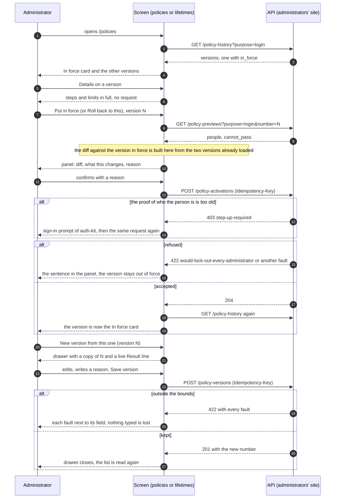
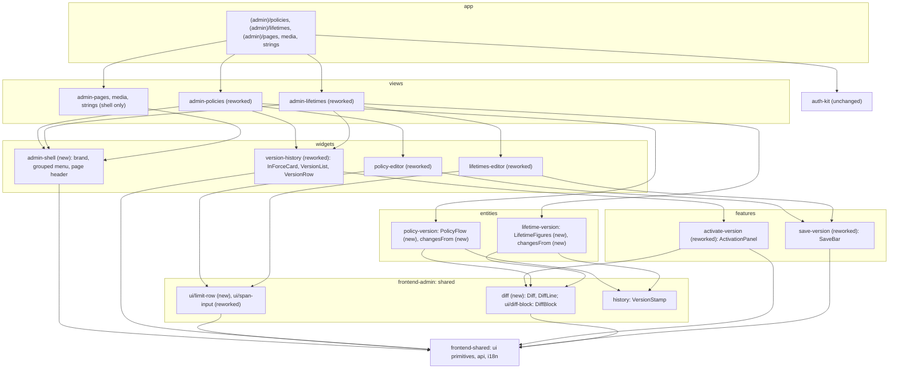
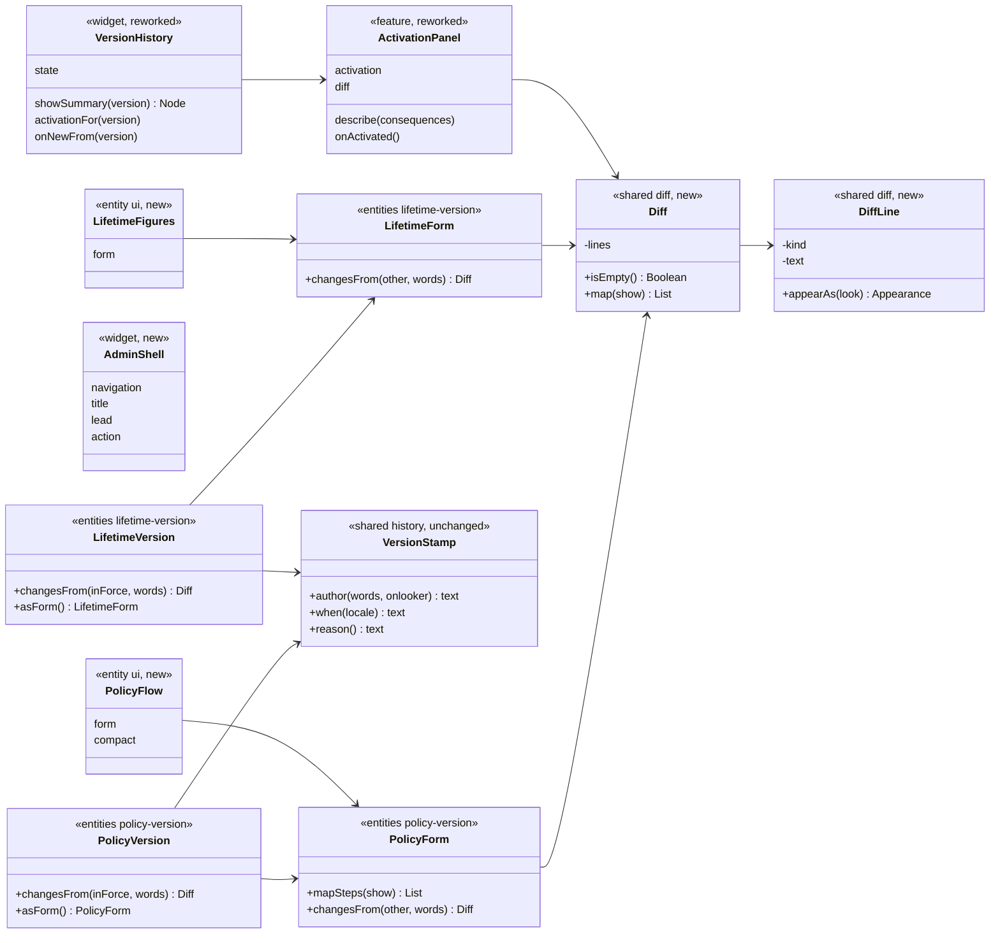

# Admin version screens, redesigned

> Layers: `frontend-admin` (a new widget, reworked widgets and features, two entities gain a display component and a method) and three small additions to `frontend-shared` (section 7). No change to `auth-kit`, the console's behaviour, or the contract of slice 7b.
> Status: plan accepted by Yurii on 2026-10-15 (forks 1 and 2 chosen as recommended; the activation panel stays as built in 7c). The diagrams below are the ones the code is written from. If the code departs from a diagram, the same PR changes the diagram.
> The decision is recorded in [ADR-101](../adr/ADR-101-the-version-screens-lead-with-the-policy-in-force-and-explain-every-field.md). It refines [ADR-099](../adr/ADR-099-the-admin-screens-keep-versions-in-place-and-let-the-server-judge-the-bounds.md) (what the screens do stays) and keeps [ADR-091](../adr/ADR-091-the-devices-screen-saves-a-name-once-and-asks-in-place.md)'s rule of no modal windows.
> The look follows the design canvas "Tallyvane auth screens" (`https://claude.ai/artifact/PkNFQuxQyAxz7aA7j47ZUf`, boards S9 and Security): a sidebar with the logo and an "admin" badge, a page heading with one primary button, cards with a heading and a line of explanation, mono version numbers, green and amber only for state.

Read it in this order: what changes and why, what was decided, how a screen runs, who depends on whom, which classes are new or changed.

## 1. What we should end up with

Slice 7c shipped the two screens working but dense: a version was a wall of text, the policy in force looked like any other row, buttons had no common width, and the drawer did not say what a switch or a number meant. The behaviour is right and stays. What changes is what a person sees first and how each control explains itself.

- **One anchor per screen.** A card "In force" at the top holds the policy (or the three lifetimes) that is working now: a name, who put it in force and why in one line, the chain of steps (or three large figures), one line of limits. It has no buttons: the page's own "New version" starts from the version in force.
- **Quiet history.** "Other versions" lists the rest: number, name, "who · when", and one column of acts at the right. "Details" opens a row in place with the chain, the limits, the reason and "New version from this". One act button per row ("Put in force" or "Roll back to this"), the same width and height in every row; "Details" is a square icon button of the same height.
- **The activation panel is unchanged in flow** and gains a block of differences between the version in force and the chosen one, drawn like the canvas (red `-`, green `+`, mono). The differences are computed on the screen from the two versions already loaded; no new request.
- **The drawer explains every field.** Three numbered parts: steps, limits, reason. A live "Result" line shows what the edits add up to. A step asks "Which of these lets a person pass this step?" with one switch per factor, a hint and the words "Accepted" or "Not accepted", then "Who is asked to pass it?" with two options in words. Limits are collapsed to one line ("Change limits"); open, each row says what it is for, the only input is at the right, and "Now: …" shows the value in force. A fault on a limit opens the part by itself.
- **The page frame follows the canvas.** A new widget `admin-shell` draws the sidebar (logo, "admin" badge, a "Content" group and a "Sign-in" group) and the page heading with the primary action; every admin page moves to it.

## 2. Decisions

The forks were answered on 2026-10-15 by "implement it" on the recommended options.

| Fork | Chosen | Why, in short |
|---|---|---|
| 1. Where the logo, the badge and the large heading live | **A.** A widget `admin-shell` in `frontend-admin`. | `AppShell` of `frontend-shared` is also the console's frame; changing it moves the console, its tests and Storybook, which is a slice of its own. All five admin pages (the three CMS placeholders included) change one import. |
| 2. How the version in force is shown | **A.** An "In force" card on top, "Other versions" below. | The reason to open the screen is to learn what works now; it is visible without a click. The cost is two layouts of a version (card and row), both made from the same display components. |

Decided without a fork:

- **A version's title is its reason**, as on the canvas; a version a migration made has none and reads "Initial version". The author and the time are the second line.
- **The purpose and the client are picked with `Tabs`** of the design system instead of four toggle buttons.
- **Differences are built by the version** (`changesFrom`), not by the screen: a version tells another version how it differs, in the words of the app. Nothing else changes in the entities.
- **The editor stays a drawer** (ADR-091). The form object (`PolicyForm`, `LifetimeForm`) and the save and fault handling are untouched; only how they are drawn changes.
- **Lifetimes are three figures** (`Stat` with `Numeric`), not a chart.
- **Only tokens of the design system, only primitives of `frontend-shared`.** No raw elements, no inline styles, no literal colours. A size no token covers becomes a component token, as the QR code did in 5c.
- **Dark theme** is not drawn separately; it comes from the tokens.
- **Strings** are English, in `en.json`, next to the existing ones.

## 3. How a screen runs (diagram 1)

The lifetimes screen is the same with `/lifetime-history`, `/lifetime-previews`, `/lifetime-versions` and `/lifetime-activations`, keyed by the client instead of the purpose.

## 4. Module dependencies (diagram 2)

## 5. Classes (diagram 3)

New and changed only. Fields are private; behaviour is in methods; a version says how it differs from another instead of handing out its fields.

Unchanged: `PolicyVersions`, `LifetimeVersions`, `PolicyActivation`, `LifetimeActivation`, `useActivation`, `useSaveVersion`, `Rejection`, `IntentionKey`, `AdminGate`. That is what "contract and behaviour unchanged" means in code.

## 6. What does not change

The 7b contract and every request; idempotency keys; the fresh-proof prompt of `auth-kit`; the bounds, which stay in the server; the names of authors (ids until the contract carries names); the console.

## 7. What changed while implementing

The diagrams above were drawn before the code; these are the places where the code differs from them or from the mockups, and why.

- **Three additions to `frontend-shared`.** (1) A layout component `PageFrame` (side-column slot, large `h1`, lead line, actions slot, `main#main-content`): the admin app may not write `main`, `aside` or a heading element itself, and `AppShell` keeps its thin top bar for the console, so `AdminShell` is built on the new frame. (2) `SidebarNav` takes an optional `label` for its landmark, so the two groups of the side column are two distinct navigation landmarks. (3) The Tailwind theme named the stacking roles `--z-*`, a namespace Tailwind generates nothing from, so `z-modal` and `z-scrim` were never CSS rules; a `Tabs` tab (`z-10`) drew over an open drawer. They are now `--z-index-*`. This is a fix of the theme, not part of the design.
- **"Details" is a text button, not a square icon button.** `frontend-shared` has no `Icon` primitive yet (and the admin may not import `lucide-react`). The two acts of a row are one row with fixed proportions (a third and two thirds of a third of the list), so they line up in every row; the theme has no fixed-width tokens.
- **`DiffBlock` lives in `shared/ui/diff-block`**, next to `span-input`, not in `shared/diff`; `shared/diff` holds `Diff` and `DiffLine` only. A new `shared/ui/limit-row` draws one limit (name, sentence, the single input, "Now: …"); `SpanInput` lost its own label and became the number and unit side by side.
- **A limit reads top to bottom, always:** name, sentence, input, "Now: …". The mockup put the sentence at the left and the input at the right; in a drawer of 28 rem that only fitted some of the rows and made the three look different.
- **The drawer has three zones:** the title and the "Result" line stay at the top, the steps and limits scroll, the reason and the buttons stay at the bottom. A fault on a limit opens "Change limits" and scrolls to the fault.
- **The "Now: …" values** come from the version in force, which the view passes to the editor (`PolicyHistory.inForce()`, `LifetimeHistory.inForce()` are new).
- **The details of a row do not repeat the reason:** a version's reason is its title.
- **Cancel and the confirming button** fill the row in equal halves, in the panel and in the drawer.
- **The three CMS placeholders and the page editor** moved to `AdminShell`; `adminNavItems` became `adminNavGroups`.
- **The drawer is 40 rem wide, not 28.** After the first review the editor felt narrow, so the `drawer.width` component token now points at layout primitive `640`; the panel is capped at the viewport width. Both editors are its only consumers. A centred dialog was considered and not taken: ADR-091 keeps the product free of modal windows (`Dialog` is reserved for a session that cannot go on, ADR-089), and the drawer keeps the page it was opened from in view at the side.
